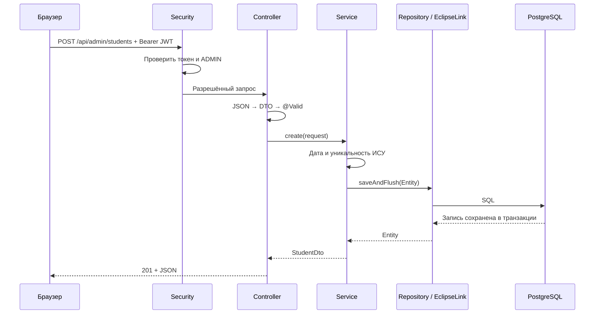
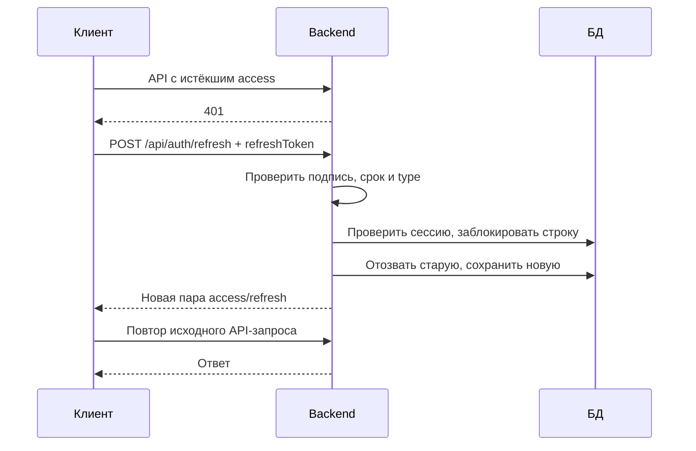

# Подготовка к защите лабораторной №3

Все 16 вопросов из задания: теория, объяснение на примере проекта, фрагменты кода и короткие ответы для защиты.

**Наш вариант:** Java 17, Spring Boot 3.3.4, EclipseLink/JPA, PostgreSQL, Spring Security, JWT access/refresh, BCrypt. Клиент — HTML/CSS/JavaScript. Подробная инструкция запуска находится в [README](README.md).

## Как пользоваться конспектом

Для каждого вопроса прочитайте объяснение, откройте указанный файл и проследите выполнение кода. Блок «Ответ на защите» помогает сформулировать мысль; он не заменяет понимание. Код ниже — сокращённые фрагменты проекта, если не указано «учебный пример». Сокращённые фрагменты с `...` не предназначены для копирования как готовые файлы.

Сначала научитесь объяснять один полный путь: **вход → JWT → проверка роли → создание студента → запись в PostgreSQL → JSON-ответ**. Затем разберите детали по вопросам.

## Содержание

1. [Java и JVM](#1-java-и-jvm)
2. [Spring Boot и Java EE / Jakarta EE](#2-spring-boot-и-java-ee--jakarta-ee)
3. [ООП в Java](#3-ооп-в-java)
4. [Аннотации](#4-аннотации)
5. [Dependency Injection и Inversion of Control](#5-dependency-injection-и-inversion-of-control)
6. [Архитектура backend](#6-архитектура-backend)
7. [Исключения и обработка ошибок](#7-исключения-и-обработка-ошибок)
8. [Реляционная БД и ключи](#8-реляционная-бд-и-ключи)
9. [Связи между сущностями](#9-связи-между-сущностями)
10. [ORM и отображение объектов](#10-orm-и-отображение-объектов)
11. [Транзакции](#11-транзакции)
12. [Аутентификация и авторизация](#12-аутентификация-и-авторизация)
13. [JWT, access и refresh](#13-jwt-access-и-refresh)
14. [Роли и защита ресурсов](#14-роли-и-защита-ресурсов)
15. [Хеширование паролей, соль и BCrypt](#15-хеширование-паролей-соль-и-bcrypt)
16. [Конфигурация, секреты и окружение](#16-конфигурация-секреты-и-окружение)

В конце: [маршрут демонстрации](#демонстрация-на-защите), [частые ошибки в ответах](#что-не-стоит-утверждать-на-защите), [шпаргалка](#шпаргалка-перед-защитой).

## 1. Java и JVM

**Вопрос:** Java в серверной веб-разработке. Особенности языка и платформы JVM.

### Теория

Java — язык со статической типизацией: типы проверяются при компиляции. Большинство прикладного кода организуется в классы; память для объектов освобождает сборщик мусора. Исходный `.java` компилируется в байткод `.class`, который выполняет JVM. Реализация JVM может интерпретировать байткод и компилировать часто выполняемый код в машинные инструкции через JIT. Переносимость не исключает зависимости от версии Java, библиотек и ОС. [Спецификация JVM 17](https://docs.oracle.com/javase/specs/jvms/se17/html/jvms-1.html).

| Термин | Значение в нашей работе |
| --- | --- |
| JDK | Комплект разработки, в том числе `javac` и средства запуска |
| JVM | Выполняет байткод приложения |
| Maven | Организует сборку и зависимости; это не JVM и не язык |
| Spring Boot | Библиотеки и настройки серверного приложения; это не компилятор |
| JavaScript | Язык клиентского кода в браузере, отдельный от Java |
| JSON | Формат данных запросов/ответов, а не язык backend |

### В нашей лабе

Откройте [`StudentManagementApplication.java`](src/main/java/dev/geeks/studentmanagement/StudentManagementApplication.java):

```java
@SpringBootApplication
public class StudentManagementApplication {
    public static void main(String[] args) {
        SpringApplication.run(StudentManagementApplication.class, args);
    }
}
```

`main` — точка входа. `static` позволяет вызвать метод без создания объекта этого класса, `void` означает отсутствие возвращаемого значения. `args` — аргументы командной строки. Выражение `.class` передаёт объект с информацией о классе, а не экземпляр приложения.

`SpringApplication.run` создаёт контекст Spring и запускает встроенный веб-сервер. Tomcat получает HTTP-запросы, Spring направляет их контроллерам. JVM продолжает выполнять процесс, пока сервер работает. PostgreSQL — другой процесс: он не находится «внутри Java».

```text
StudentController.java → компиляция → StudentController.class → JVM → обработка HTTP
```

Для сравнения с C++: `javac` играет роль компилятора, но результат обычно не самостоятельный нативный `.exe`. GC не освобождает за вас все внешние ресурсы: соединения и файлы всё равно нужно закрывать или доверять библиотеке, которая ими управляет.

### Ответ на защите

> Backend написан на Java 17. Maven собирает исходники в байткод и скачивает зависимости. JVM выполняет приложение, а Spring Boot запускает встроенный Tomcat и организует обработку HTTP. JavaScript у нас работает в браузере, JSON используется для обмена данными.

**Уточнения:** Почему нужен JDK? Чтобы компилировать. Что делает GC? Освобождает память объектов, ставших недоступными; точный момент не гарантируется. Почему сохранение файла не меняет работающий сервер? Без настроенного hot reload нужно пересобрать и перезапустить процесс.

## 2. Spring Boot и Java EE / Jakarta EE

**Вопрос:** Основные отличия и подходы к разработке.

### Теория

Spring — самостоятельная экосистема библиотек. Spring Boot упрощает её настройку: starter-зависимости, автоконфигурация, удобный запуск. Jakarta EE — платформа спецификаций для серверной Java; приложение использует их реализации. Java EE — прежнее название платформы, позднее развитие перешло к Jakarta EE. Современные Jakarta API часто используют пакет `jakarta.*`. [Jakarta EE Tutorial](https://jakarta.ee/learn/docs/jakartaee-tutorial/current/).

| Задача | Наш Spring Boot | Типичный подход Jakarta EE |
| --- | --- | --- |
| HTTP API | Spring MVC, `@RestController` | Jakarta REST, `@Path` |
| Внедрение зависимостей | Контейнер Spring, конструкторы | CDI, например `@Inject` |
| Работа с БД | Spring Data JPA + EclipseLink | Jakarta Persistence + выбранный провайдер |
| Запуск | Исполняемый JAR со встроенным сервером | Часто приложение в совместимом сервере; существуют и другие модели запуска |

Это не две версии Java. Они могут использовать общие API; Spring Boot 3 тоже применяет Jakarta Persistence и Jakarta Validation. Наличие импорта `jakarta.persistence.Entity` само по себе не означает, что приложение построено на полном Jakarta EE-сервере.

### В нашей лабе

В [`pom.xml`](pom.xml) подключены starters Web, Security, Data JPA и Validation. В [`JpaConfig.java`](src/main/java/dev/geeks/studentmanagement/config/JpaConfig.java) выбран провайдер:

```java
factory.setJpaVendorAdapter(new EclipseLinkJpaVendorAdapter());
```

Наш «Spring/Eclipse» — это **Spring Boot + EclipseLink**, а не обязательное использование редактора Eclipse. Мы работаем в VS Code. EclipseLink выполняет работу ORM; Hibernate исключён из starter-зависимостей.

### Ответ на защите

> Spring Boot упрощает создание приложения на Spring, а Jakarta EE задаёт набор стандартных серверных API и требует их реализаций. Мы используем Spring Boot для HTTP, зависимостей и безопасности, а EclipseLink как реализацию JPA. Jakarta-аннотации в Entity используются и внутри Spring-проекта.

**Уточнения:** Spring Boot заменяет Java? Нет. EclipseLink — БД? Нет, он взаимодействует с PostgreSQL. Eclipse IDE обязателен? Нет. Нужно ли отдельно ставить Tomcat? Для нашего JAR нет, он включён через зависимости.

## 3. ООП в Java

**Вопрос:** Классы, интерфейсы, наследование и полиморфизм.

### Теория

Класс описывает поля и поведение объектов. Интерфейс задаёт контракт; конкретные классы реализуют его. В Java класс наследует один класс через `extends`, но может реализовать несколько интерфейсов через `implements`. Инкапсуляция ограничивает прямой доступ к состоянию. Полиморфизм позволяет использовать разные реализации через общий тип. Переопределение метода отличается от перегрузки: перегрузка меняет набор параметров, переопределение — реализацию у наследника. [Наследование](https://docs.oracle.com/javase/tutorial/java/IandI/subclasses.html), [полиморфизм](https://docs.oracle.com/javase/tutorial/java/IandI/polymorphism.html).

### В нашей лабе

**Класс и инкапсуляция:** [`Student.java`](src/main/java/dev/geeks/studentmanagement/student/model/Student.java).

```java
private Integer room;

public Integer getRoom() { return room; }
public void setRoom(Integer room) { this.room = room; }
```

Снаружи поле нельзя менять напрямую; доступ идёт через методы. `this.room` — поле текущего объекта, `room` — аргумент метода. Наш setter не проверяет диапазон: правила проверяются через DTO/сервис. `private` сам по себе не делает данные корректными.

**Интерфейс:** [`StudentRepository.java`](src/main/java/dev/geeks/studentmanagement/student/repository/StudentRepository.java).

```java
public interface StudentRepository
        extends JpaRepository<Student, Integer>,
                JpaSpecificationExecutor<Student> {
}
```

Интерфейс расширяет два интерфейса. Spring Data создаёт реализацию/прокси, которым пользуется сервис. `Student` — тип сущности, `Integer` — тип её ключа; угловые скобки задают generics.

**Наследование:** `NotFoundException extends RuntimeException`; `JwtAuthenticationFilter extends OncePerRequestFilter`. Во втором случае мы переопределяем `doFilterInternal` и используем механизм родительского класса.

**Полиморфизм:** поле `PasswordEncoder passwords` имеет интерфейсный тип, но Spring передаёт `BCryptPasswordEncoder`. Вызов `passwords.matches(...)` выполняется конкретной реализацией.

**DTO-record:** `StudentDto` и `RegisterRequest` — records. Java создаёт конструктор, методы доступа вроде `request.name()`, `equals`, `hashCode`, `toString`. Поля-компоненты final; это не гарантия глубокой неизменяемости любых вложенных объектов.

### Ответ на защите

> Entity — классы с закрытыми полями. Репозитории — интерфейсы, реализации предоставляет Spring Data. JWT-фильтр и наши исключения используют наследование. Полиморфизм виден на PasswordEncoder: сервис зависит от интерфейса, а работает реализация BCrypt. Для DTO применены records.

**Уточнения:** `final repository` делает объект БД неизменяемым? Нет, нельзя переназначить ссылку. Интерфейс — готовый объект? Нет, нужна реализация. Надо наследовать Service от Repository? Нет: сервис использует репозиторий через композицию.

## 4. Аннотации

**Вопрос:** Аннотации в Java и их использование в серверных приложениях.

### Теория

Аннотация — метаданные для компилятора, инструментов или библиотек. Она начинается с `@`, может иметь параметры и разные сроки сохранения. Не всякая аннотация доступна во время выполнения. Аннотация не «выполняет код сама»: её обрабатывает соответствующий механизм. [Основы аннотаций Java](https://docs.oracle.com/javase/tutorial/java/annotations/basics.html).

### В нашей лабе

| Аннотация | Что она сообщает |
| --- | --- |
| `@SpringBootApplication` | Главная конфигурация, сканирование компонентов и автоконфигурация |
| `@RestController` | Контроллер, результат метода записывается в HTTP-тело |
| `@GetMapping`, `@PostMapping` | Метод HTTP и адрес обработчика |
| `@RequestBody` | Прочитать тело запроса и преобразовать в DTO |
| `@PathVariable` | Взять значение из пути, например ИСУ |
| `@Service` | Зарегистрировать сервис как Spring-компонент |
| `@Configuration`, `@Bean` | Класс настроек и создание управляемых объектов |
| `@Entity`, `@Table`, `@Id`, `@Column` | Отображение класса/полей на таблицу |
| `@Valid`, `@NotNull`, `@Min`, `@Pattern` | Запуск и правила валидации |
| `@Transactional` | Требования к транзакции метода |
| `@RestControllerAdvice`, `@ExceptionHandler` | Общая обработка ошибок |
| `@Override` | Компилятор проверяет, что метод переопределяет унаследованный |

```java
@PostMapping("/api/admin/students")
public ResponseEntity<Map<String, StudentDto>> createStudent(
        @Valid @RequestBody StudentCreateRequest request) {
    var student = service.create(request);
    return ResponseEntity.status(201).body(Map.of("data", student));
}
```

Spring MVC выбирает обработчик, читает JSON в record, запускает Validator и только затем вызывает метод с корректным DTO. При нарушении ограничения возникает исключение и управление уходит обработчику ошибок. Один лишь `@NotNull` без запуска валидации не проверяет произвольный вызов конструктора.

Для PATCH мы вручную вызываем `validator.validate(merged)` после объединения полей, поскольку частичный запрос отличается от полного.

### Ответ на защите

> Аннотации описывают назначение класса или метода. Spring обрабатывает маршруты и компоненты, EclipseLink — JPA-аннотации, Validator — ограничения DTO. Например, @Valid @RequestBody включает проверку JSON-запроса перед созданием студента.

**Уточнения:** Почему обычный класс с именем Controller раньше не отвечал на запросы? Имя само по себе не регистрирует обработчик. `@Entity` делает класс HTTP-контроллером? Нет, это другая ответственность.

## 5. Dependency Injection и Inversion of Control

**Вопрос:** DI и IoC.

### Теория

IoC — передача управления инфраструктуре: например, контейнеру поручают создание и связывание компонентов. DI — способ этого связывания, когда зависимости передаются объекту извне. Объект, управляемый контейнером Spring, называется bean. DI можно реализовать и без Spring. [Контейнер Spring и DI](https://docs.spring.io/spring-framework/reference/core/beans/introduction.html).

### В нашей лабе

```java
private final StudentService service;

public StudentController(StudentService service) {
    this.service = service;
}
```

Контроллер не делает `new StudentService(...)`. Spring находит `@Service`, создаёт его с репозиторием и Validator, затем передаёт готовую зависимость контроллеру. Цепочка:

```text
Spring создаёт Repository → передаёт Service → передаёт Controller
```

Фабричный метод в `SecurityConfig`:

```java
@Bean
public PasswordEncoder passwordEncoder() {
    return new BCryptPasswordEncoder();
}
```

`new` здесь нормален: метод конфигурации создаёт объект, который затем становится bean. Мы не запрещаем создание объектов вообще; сущности и DTO тоже создаются через `new`.

Преимущества для проекта: у зависимостей явные конструкторы, легче заменить реализацию, обязанности создания не смешаны с обработкой запроса. Например, `AuthService` получает `PasswordEncoder`, а не занимается его настройкой.

Наша прежняя ошибка `entityManagerFactory could not be found` означает, что контейнер не мог собрать зависимость репозитория: файл `JpaConfig` был пустым/несохранённым. Сообщение о bean — сообщение о недостающем объекте в графе зависимостей, а не о Java-папке.

### Ответ на защите

> Spring управляет созданием компонентов — это IoC. Зависимости передаются через конструкторы — это DI. StudentController получает StudentService, а сервис получает Repository и Validator. Настраиваемые библиотечные объекты создаём через @Bean.

**Уточнения:** DI и IoC синонимы? DI — конкретный механизм IoC. Нужен ли `@Autowired` на единственном конструкторе? В нашем Spring — нет. Все `new User()` управляются Spring? Нет, Entity не становится bean только из-за `@Entity`.

## 6. Архитектура backend

**Вопрос:** Разделение ответственности между слоями.

### Теория на нашем проекте

Разделение слоёв помогает менять HTTP-контракт, бизнес-правила и хранение данных независимо. Это выбранная архитектура проекта, а не обязанность Java иметь именно такие названия пакетов.

| Часть | Задача | Файл |
| --- | --- | --- |
| Security/filter | Установить пользователя и проверить доступ | `JwtAuthenticationFilter`, `SecurityConfig` |
| Controller | Принять HTTP, вызвать сервис, сформировать статус/DTO | `StudentController` |
| Service | Дата, уникальность ИСУ, CRUD, фильтры | `StudentService` |
| Repository | Сохранение и запросы через JPA | `StudentRepository` |
| Entity | Структура хранения | `Student`, `User`, `RefreshSession` |
| DTO | Контракт запросов и ответов | `StudentCreateRequest`, `StudentDto` |
| Mapper | Перевод между Entity и DTO | `StudentMapper` |
| Advice | Единый формат ошибок | `GlobalExceptionHandler` |

### Как проходит POST студента



Действительный commit транзакции происходит при завершении транзакционного вызова сервиса, а не просто из-за слова `flush`.

Почему DTO отличается от Entity? Например, у `User` есть `passwordHash`, который клиенту не нужен. Изменение модели хранения не должно автоматически раскрывать внутренние поля через JSON. Мы явно формируем безопасные ответы, а не возвращаем Entity пользователя целиком.

`PageResponse<StudentDto>` содержит список и сведения о странице. `StudentCreateRequest` требует обязательные поля, `StudentUpdateRequest` допускает их отсутствие. Mapper не принимает решения о роли пользователя и не открывает соединение с БД.

### Ответ на защите

> Контроллер отвечает за HTTP, сервис — за бизнес-правила, репозиторий — за доступ к данным. Entity описывает хранение, DTO — API, Mapper преобразует между ними. Проверка ролей находится в Security, обработка ошибок — в общем Advice. Поэтому логика не собрана в одном контроллере.

**Уточнения:** Где проверяется уникальность? Сервис делает предварительную проверку, ограничения БД обеспечивают окончательную гарантию. Где проверяются диапазоны? DTO через Validator; при PATCH — собранный полный DTO. Все правила должны быть только в аннотациях? Нет, дата и бизнес-проверки находятся в сервисе.

## 7. Исключения и обработка ошибок

**Вопрос:** Исключения в Java и централизованная обработка ошибок.

### Теория

Исключение прерывает обычный путь выполнения и передаёт управление подходящему обработчику. `throw` выбрасывает объект, `try/catch` перехватывает его, `finally` выполняет завершающие действия при обычном выходе из блока. Checked-исключения нужно обработать или объявить через `throws`; наследники `RuntimeException` — unchecked. `Error` обычно обозначает проблемы уровня среды выполнения. [Исключения Java](https://docs.oracle.com/javase/tutorial/essential/exceptions/index.html).

### В нашей лабе

В `StudentService` отсутствие студента выражено исключением:

```java
var student = repository.findById(isu)
    .orElseThrow(() -> new NotFoundException("Студент не найден"));
```

`Optional` содержит запись либо пуст. Лямбда `() -> ...` создаёт исключение при отсутствии записи. Само это выражение не устанавливает HTTP-статус; статус выбирает обработчик.

В [`GlobalExceptionHandler.java`](src/main/java/dev/geeks/studentmanagement/common/error/GlobalExceptionHandler.java), фрагмент с форматированием:

```java
@ExceptionHandler(NotFoundException.class)
public ResponseEntity<?> missing(NotFoundException exception) {
    return error(404, exception.getMessage(), Map.of());
}
```

`@RestControllerAdvice` охватывает контроллеры, поэтому им не нужен одинаковый `try/catch` в каждом методе. Ошибки валидации DTO переводятся в `422`, дубли ИСУ/аккаунта — в `409`, отсутствующий ресурс — в `404`. Некорректный JSON/тип параметра получает `400`.

```json
{
  "error": {
    "code": "NOT_FOUND",
    "message": "Студент не найден",
    "status": 404,
    "timestamp": "2026-10-14T12:00:00Z",
    "details": {}
  }
}
```

Неожиданная ошибка логируется на сервере; клиент получает общее сообщение `500`, а не stack trace и параметры БД.

**Важная граница:** `401` и `403` создаются в Security entry point / access denied handler. Ошибки фильтра возникают до контроллера, поэтому один ControllerAdvice не решает обработку всех отказов доступа. В `SecurityConfig` формируется тот же `ApiError`.

### Ответ на защите

> Бизнес-ошибки выражаются исключениями. Общий ControllerAdvice переводит их в согласованные HTTP-статусы и JSON. Отсутствие студента даёт 404, конфликт — 409, валидация — 422. Отказы безопасности обрабатываются отдельно в цепочке Security, но формат ответа общий.

**Уточнения:** Любая ошибка — 500? Нет. Можно ли вернуть `200` с текстом «ошибка»? Это неверно описывает результат для клиента. Почему `SQLException` в JpaConfig имеет `throws`? Это checked-исключение настройки подключения; при нём приложение не может нормально стартовать.

## 8. Реляционная БД и ключи

**Вопрос:** Таблицы, строки, столбцы, первичные и внешние ключи.

### Теория

Таблица описывает набор однотипных записей: строка — запись, столбец — атрибут с типом. PRIMARY KEY однозначно идентифицирует строку и не допускает NULL/дубли. UNIQUE запрещает дубли по указанным полям, но не тождественен PRIMARY KEY. FOREIGN KEY проверяет ссылку на существующую запись другой/той же таблицы. Ограничения защищают данные независимо от клиента. [Ограничения PostgreSQL](https://www.postgresql.org/docs/18/ddl-constraints.html).

### В нашей лабе

| Таблица | Первичный ключ | Прочие важные поля |
| --- | --- | --- |
| `students` | `isu` — Integer, задаётся при создании | ФИО, группа, общежитие, комната, дата, заметка |
| `app_users` | `id` — Long, генерируется провайдером/БД | Уникальные username/email, passwordHash, role |
| `refresh_sessions` | `id` — строковый идентификатор токена | username, expiresAt, revoked |

Фрагменты Entity:

```java
// Student
@Id
@Column(name = "isu", nullable = false)
private Integer isu;

// User
@Id
@GeneratedValue(strategy = GenerationType.AUTO)
private Long id;

@Column(nullable = false, unique = true, length = 50)
private String username;
```

`AUTO` поручает выбор способа генерации провайдеру: не стоит обещать, что это всегда именно AUTO_INCREMENT. ИСУ у студентов генерировать случайно не нужно — это существующий предметный идентификатор.

**Учебное SQL-представление**, не точная миграция EclipseLink:

```sql
CREATE TABLE students (
    isu INTEGER PRIMARY KEY,
    name VARCHAR(200),
    student_group VARCHAR(20),
    room INTEGER
);
```

Обратите внимание: в текущем Entity все ограничения API не продублированы как SQL CHECK. Например, диапазон комнаты проверяется DTO, а PK обеспечивается базой. Гарантии нужно различать.

`refresh_sessions.username` у нас просто строка: **внешнего ключа на app_users сейчас нет**. Совпадающее имя поля не создаёт FK автоматически.

**Три значения слова «ключ»:** PK/FK в схеме БД; пароль подключения `DB_PASSWORD`; секрет подписи JWT. Это разные понятия и разные задачи.

### Ответ на защите

> PostgreSQL хранит записи в таблицах. У студента первичный ключ — ИСУ, у пользователя — автоматически создаваемый id. Username и email дополнительно уникальны. Внешний ключ гарантировал бы ссылку на существующую запись, но в текущих Entity связи через FK не объявлены.

**Уточнения:** Почему проверки `existsById` недостаточно? Два запроса могут проверить одновременно; от дубля окончательно защищает PK. UNIQUE делает поле первичным ключом? Нет. Пароль PostgreSQL — первичный ключ? Нет.

## 9. Связи между сущностями

**Вопрос:** Один-к-одному, один-ко-многим, многие-ко-многим.

### Теория и примеры для предметной области

| Связь | Пример | Типичное хранение |
| --- | --- | --- |
| 1:1 | Студент и его единственный профиль | FK с UNIQUE на одной стороне |
| 1:N | Общежитие и много студентов | FK dormitory_id в таблице студентов |
| N:M | Студенты и учебные курсы | Таблица student_courses с двумя FK |

Направление обхода в Java и размещение внешнего ключа — не одно и то же. Связь можно отображать с одной стороны или с двух. Для двусторонней связи нужно определить владельца; `mappedBy` указывает поле на другой стороне, которое управляет отображением. [Jakarta Persistence: сущности и отношения](https://jakarta.ee/learn/docs/jakartaee-tutorial/current/persist/persistence-intro/persistence-intro.html).

### Что действительно есть в нашей лабе

`Student.dormitory` — число, `Student.group` — строка, `RefreshSession.username` — строка. Нет Entity `Dormitory`, `Course`, `StudentProfile` и аннотаций `@ManyToOne` / `@OneToMany`. Поэтому **следующие примеры объясняют теорию и возможное развитие проекта, а не существующий код**.

**Учебный пример 1:N:**

```java
// В Student: много студентов могут относиться к одному общежитию.
@ManyToOne(fetch = FetchType.LAZY)
@JoinColumn(name = "dormitory_id")
private Dormitory dormitory;

// В Dormitory: обратная сторона.
@OneToMany(mappedBy = "dormitory")
private List<Student> students;
```

FK находится в students. `mappedBy = "dormitory"` — имя Java-поля Student, а не SQL-колонки `dormitory_id`.

**Учебный пример 1:1:**

```java
@OneToOne
@JoinColumn(name = "profile_id", unique = true)
private StudentProfile profile;
```

**Учебный пример N:M:**

```java
@ManyToMany
@JoinTable(
    name = "student_courses",
    joinColumns = @JoinColumn(name = "student_id"),
    inverseJoinColumns = @JoinColumn(name = "course_id")
)
private Set<Course> courses;
```

Если у участия в курсе есть дата, оценка или статус, соединительную таблицу лучше представить отдельной Entity Enrollment. Это позволяет хранить свойства самой связи.

Ссылки могут загружаться сразу или отложенно. При добавлении отношений потребуются решения о загрузке, DTO и каскадах; `CascadeType.REMOVE` не следует ставить автоматически, особенно на общие справочники.

### Ответ на защите

> Связи отличаются количеством записей на каждой стороне. 1:N обычно хранится через FK на стороне «много», N:M — через соединительную таблицу. В текущей лабе связи Entity не реализованы: общежитие — числовое поле. Я могу показать, как развить модель до Dormitory и ManyToOne, но не выдаю это за готовую реализацию.

**Уточнения:** `List<Student>` без аннотаций создаст таблицу связи? Нет. Что делает UNIQUE у FK? Ограничивает повторное использование связанной записи. Почему не отдавать двусторонние Entity прямо в JSON? Можно получить циклическую сериализацию и раскрыть внутреннюю модель; нужны DTO.

## 10. ORM и отображение объектов

**Вопрос:** Назначение ORM, преимущества и особенности отображения объектов на реляционную модель.

### Теория

ORM связывает объектную модель с таблицами: поля с колонками, идентификаторы с ключами, операции над объектами с SQL. JPA задаёт API и правила; EclipseLink их реализует. ORM уменьшает повторяющийся код, но SQL и соединение с БД остаются: производительность, ограничения и порядок загрузки нужно понимать. [Spring: интеграция JPA](https://docs.spring.io/spring-framework/reference/data-access/orm/jpa.html).

### В нашей лабе

```java
@Entity
@Table(name = "students")
public class Student {
    @Id
    private Integer isu;

    @Column(name = "student_group")
    private String group;
}
```

Один объект Student соответствует одной записи students. Java-поле `group` сохраняется в колонку `student_group`. У User роль отмечена `@Enumerated(EnumType.STRING)`, поэтому сохраняется имя `USER`/`ADMIN`, а не порядковый номер enum.

```java
var student = StudentMapper.fromCreateRequest(request);
var savedStudent = repository.saveAndFlush(student);
return StudentMapper.toDto(savedStudent);
```

Репозиторий вызывает JPA, EclipseLink готовит SQL, драйвер JDBC передаёт его PostgreSQL. `save` не обязан всегда делать INSERT: сохранение может включать merge существующего объекта. `flush` синхронизирует изменения с БД в текущей транзакции, но **не равен commit**.

В `JpaConfig` задаются DataSource, пакет Entity, EclipseLink adapter и создание/дополнение таблиц. `EntityManagerFactory` создаёт EntityManager; это инфраструктура управления persistence context. Репозитории позволяют не писать EntityManager вручную в каждом методе.

**Особенности текущего проекта:** weaving отключён, версия Entity не объявлена (`@Version` нет), отношения Entity отсутствуют. Нельзя заявлять, что приложение автоматически предотвращает потерю обновлений при любых параллельных PUT/PATCH. Для такого требования нужна отдельная стратегия блокировок/версий.

### Ответ на защите

> ORM позволяет сохранять Java-объекты в реляционную БД через mapping. JPA — спецификация, EclipseLink — провайдер. Entity Student описывает таблицу и колонки, Repository предоставляет операции. DTO отделяет внешнее JSON-представление от Entity. ORM генерирует SQL, а не отменяет его.

**Уточнения:** Hibernate и JPA одно? Нет. DTO автоматически хранится в БД? Нет, у нас хранится Entity. Изменение Entity автоматически исправляет все старые типы колонок? Нет; в лабе есть отдельное расширение note, а полноценного инструмента миграций нет.

## 11. Транзакции

**Вопрос:** Основные свойства транзакций и применение в backend.

### Теория

Транзакция объединяет операции: `COMMIT` фиксирует результат, `ROLLBACK` отменяет изменения. ACID: атомарность — всё или ничего; согласованность — сохранение заданных ограничений; изоляция — правила видимости параллельных операций; долговечность — сохранение подтверждённого результата. Изоляция имеет уровни и не означает, что никакие параллельные запросы невозможны. [Транзакции PostgreSQL](https://www.postgresql.org/docs/18/tutorial-transactions.html).

Spring `@Transactional` обычно работает через прокси. По умолчанию runtime-исключения и Error вызывают rollback; checked-исключения требуют настройки, если нужен такой же эффект. `readOnly` — указание инфраструктуре, а не универсальный запрет записи. Внутренний вызов метода через `this` не проходит заново через обычный proxy-interceptor. [Настройки @Transactional](https://docs.spring.io/spring-framework/reference/data-access/transaction/declarative/annotations.html).

### В нашей лабе

```java
@Transactional
public StudentDto create(StudentCreateRequest request) {
    // Проверка даты и дубликата.
    var student = StudentMapper.fromCreateRequest(request);
    var savedStudent = repository.saveAndFlush(student);
    return StudentMapper.toDto(savedStudent);
}
```

Контроллер вызывает прокси сервиса. Менеджер транзакций открывает/присоединяет транзакцию, метод работает с БД, успешное завершение фиксирует изменения. `ConflictException` и `ResponseStatusException` — runtime-исключения.

Более показательный пример — refresh в `AuthService`:

```java
@Transactional
public TokenResponse refresh(String token) {
    var claims = jwt.validateRefreshToken(token);
    var session = sessions.findForRotation(claims.getId())
        .orElseThrow(this::unauthorized);
    // Проверка срока, владельца и revoked.
    var user = users.findByUsername(claims.getSubject())
        .orElseThrow(this::unauthorized);
    session.revoke();
    sessions.saveAndFlush(session);
    return issue(user);
}
```

Откат при ошибке помогает не оставить старый refresh отозванным без записи новой сессии. `findForRotation` использует `PESSIMISTIC_WRITE`: строка блокируется для согласованной ротации при конкурирующих запросах.

В PATCH метод `patch()` вызывает `replace()` напрямую внутри того же объекта. Новая proxy-транзакция на `replace` здесь не открывается, но **транзакция patch уже действует**, поэтому работа остаётся транзакционной.

Транзакция БД не делает доставку HTTP атомарной: если данные зафиксированы, но соединение с клиентом оборвалось, клиент может не получить ответ. Повтор запроса надо проектировать отдельно.

### Ответ на защите

> Транзакция обеспечивает согласованное выполнение группы действий. В сервисах используется @Transactional, а менеджер настроен как JpaTransactionManager. Особенно это важно при refresh: отзыв старой сессии и создание новой выполняются вместе. Для конкурентной ротации используется блокировка строки.

**Уточнения:** `saveAndFlush` завершает транзакцию? Нет. Две предварительные проверки уникальности заменяют PK/UNIQUE? Нет. Любая аннотация на внутреннем вызове сработает заново? При обычных Spring-прокси нет. Есть `@Version` у Student? Сейчас нет.

## 12. Аутентификация и авторизация

**Вопрос:** В чём различие?

### Теория

**Аутентификация:** установление личности — «кто обращается?». **Авторизация:** проверка полномочий — «что этому пользователю разрешено?». Успешный вход не даёт права на все операции. Spring Security хранит установленного пользователя и его authorities в Authentication внутри SecurityContext. [Архитектура аутентификации Spring Security](https://docs.spring.io/spring-security/reference/servlet/authentication/architecture.html).

### В нашей лабе

1. `AuthController` получает LoginRequest.
2. `AuthService.login` ищет аккаунт по username либо email.
3. `PasswordEncoder.matches` проверяет пароль.
4. При успехе выдаётся пара JWT.
5. При следующем запросе `JwtAuthenticationFilter` проверяет access-токен и создаёт Authentication.
6. `SecurityConfig` разрешает или запрещает конкретную операцию по роли.

Фрагмент входа:

```java
var user = users.findByUsername(request.username())
    .or(() -> users.findByEmail(
        request.username().toLowerCase(Locale.ROOT)))
    .orElseThrow(this::unauthorized);

if (!passwords.matches(request.password(), user.getPasswordHash())) {
    throw unauthorized();
}
```

Параметр назван username, но реализован и поиск по email. Это аутентификация. После входа USER может успешно получить `GET /api/user/students`, но получит `403` при POST `/api/admin/students`: авторизация проверяется отдельно.

| Ситуация | Результат |
| --- | --- |
| Пароль при входе неверен | `401` |
| Защищённый запрос без действительного access-токена | `401` |
| USER отправляет POST создания | `403` |
| ADMIN создаёт корректного студента | `201` |
| ADMIN отправляет некорректные поля | `422` — права есть, но данные неверны |

Регистрация — создание аккаунта, а не синоним проверки пароля. В нашей реализации успешная регистрация дополнительно выдаёт токены.

### Ответ на защите

> Аутентификация проверяет личность: у нас это пароль при входе и JWT при следующих запросах. Авторизация проверяет разрешение операции по роли. Поэтому USER может быть успешно аутентифицирован, но не иметь права удалить студента; тогда ответ 403, а не 401.

**Уточнения:** JWT и роль — одно? Нет: токен подтверждает сведения, роль определяет полномочия. Если скрыта кнопка, операция защищена? Только если есть серверная проверка. Пароль PostgreSQL аутентифицирует посетителя сайта? Нет, он аутентифицирует подключение backend к БД.

## 13. JWT, access и refresh

**Вопрос:** Устройство токена, подпись, access- и refresh-токены.

### Теория

JWT — формат представления claims. Подписанный JWT в compact JWS состоит из трёх частей: header, payload, signature/MAC, разделённых точками. Header и payload кодируются Base64url; это не шифрование. Проверка подписи/MAC обнаруживает изменение содержимого. Полезные claims: `sub` — субъект, `exp` — срок, `iat` — время выдачи, `jti` — идентификатор. [RFC 7519](https://www.rfc-editor.org/rfc/rfc7519.html).

Access используется для API и обычно короткоживущий. Refresh используется для получения нового access и не должен приниматься как его замена. Это роли токенов в нашей схеме, а не отдельные обязательные форматы JWT. JWT может быть и зашифрованным, но **у нас он подписан, не зашифрован**.

### В нашей лабе

Фрагмент [`JwtService.java`](src/main/java/dev/geeks/studentmanagement/security/JwtService.java), с переименованием переменных для читаемости:

```java
return Jwts.builder()
    .subject(user.getUsername())
    .id(id)
    .claim("role", user.getRole().name())
    .claim("type", type)
    .issuedAt(new Date())
    .expiration(Date.from(expiry))
    .signWith(key)
    .compact();
```

Наша схема симметричная: HMAC использует секретный ключ для создания и проверки MAC. При автоматически созданном ключе 32 байта JJWT выбирает HS256; `signWith(key)` выбирает совместимый алгоритм с учётом ключа, а не обязует любой пользовательский ключ иметь тот же алгоритм. [Документация JJWT](https://github.com/jwtk/jjwt).

Упрощённое представление payload — **не настоящий токен**:

```json
{
  "sub": "имя-пользователя",
  "role": "USER",
  "type": "access",
  "iat": 1700000000,
  "exp": 1700000900,
  "jti": "идентификатор-токена"
}
```

Подпись создаётся для закодированных header и payload, а не для одного поля role. Нельзя заменить `USER` на `ADMIN` и сохранить действительность токена.

Проверка, фрагмент проекта:

```java
return Jwts.parser()
    .verifyWith(key)
    .require("type", type)
    .build()
    .parseSignedClaims(token)
    .getPayload();
```

Используются разные ключи access/refresh и ожидаемый claim `type`. Библиотека проверяет подписанный токен и срок. Разделение назначений помогает предотвратить подстановку одного вида токена вместо другого. [Рекомендации по проверке JWT](https://www.rfc-editor.org/rfc/rfc8725.html).

### Как работает обновление



Access по умолчанию действует 15 минут, refresh — 30 дней. `auth.js` обновляет пару при `401`; сервер не может самостоятельно заменить токен в браузере без нового запроса клиента.

В БД хранится RefreshSession с `jti`, username, сроком и revoked; **не полный текст refresh JWT**. Старый refresh после ротации недействителен. При logout он отзывается; уже выданный access действует до exp. Фиксация сессии позволяет отзывать refresh, поэтому у системы есть серверное состояние, хотя HTTP session не используется.

### Ответ на защите

> Access JWT используется в Bearer-заголовке, refresh — для обновления. У нас разные ключи и проверка типа токена, срок access 15 минут, refresh 30 дней. Refresh-сессии хранятся в базе и ротируются: повторное использование старого токена запрещено. JWT подписан, но его payload не скрыт шифрованием.

**Уточнения:** Где секретный ключ в JWT? Он не передаётся в токене. Можно ли хранить пароль в payload? Не нужно, payload читается. Почему logout не мгновенно отменяет access? Для access у нас нет списка отзыва. Есть issuer/audience-проверки? В текущем JwtService не настроены; при нескольких сервисах это стоит рассмотреть отдельно.

## 14. Роли и защита ресурсов

**Вопрос:** Ролевая модель и защита серверных ресурсов.

### Теория

В RBAC разрешения связываются с ролями. При обработке HTTP правила должны проверяться до выполнения защищённой операции. В Spring Security `hasRole("ADMIN")` обычно проверяет authority `ROLE_ADMIN`. Порядок правил важен: применяется первое подходящее правило. [Проверка HTTP-доступа в Spring Security](https://docs.spring.io/spring-security/reference/servlet/authorization/authorize-http-requests.html).

### В нашей лабе

Из `SecurityConfig`, сокращённо:

```java
.requestMatchers(HttpMethod.GET, "/api/user/students", "/api/user/students/**")
    .hasAnyRole("USER", "ADMIN")
.requestMatchers(HttpMethod.POST, "/api/user/students/search")
    .hasAnyRole("USER", "ADMIN")
.requestMatchers("/api/user/students", "/api/user/students/**")
    .hasRole("ADMIN")
```

Сначала разрешаем чтение и поиск обеим ролям, затем остальные операции студентов — ADMIN. Если поставить общее правило первым, USER потеряет доступ к чтению. Поиск POST — отдельный маршрут: это не создание записи.

JWT-фильтр после проверки токена ищет пользователя в БД и создаёт Authentication:

```java
var authentication = new UsernamePasswordAuthenticationToken(
    user.getUsername(),
    null,
    List.of(new SimpleGrantedAuthority("ROLE_" + user.getRole().name()))
);
SecurityContextHolder.getContext().setAuthentication(authentication);
```

**Текущая роль берётся из базы**, а не слепо из claim role. В JWT claim role есть для клиентского интерфейса, но решение backend основывается на актуальном User. После изменения роли интерфейс до обновления токена может отображать прежние кнопки, однако сервер проверяет текущие права.

| Операция | USER | ADMIN |
| --- | --- | --- |
| Список, досье, поиск | Да | Да |
| Создание | Нет | Да |
| PUT/PATCH | Нет | Да |
| Удаление | Нет | Да |

HTML и статика доступны без входа, защищаются API-данные. Swagger открыт для просмотра, но защищённые запросы требуют токен. `QueryMethodFilter` преобразует QUERY поиска до Security, чтобы он получил правила поиска.

`SessionCreationPolicy.STATELESS` означает отсутствие хранения аутентификации в HTTP session. Это не обещает отсутствие любых обращений к БД: наш фильтр читает пользователя, refresh использует сохранённые сессии.

CSRF-проверка отключена для API со вручную добавляемым Authorization-заголовком; cookie-аутентификация не используется. Это решение нельзя автоматически переносить на другое приложение с cookie-сессиями. `sessionStorage` доступен JavaScript, поэтому XSS остаётся значимым риском.

### Ответ на защите

> USER читает и ищет, ADMIN выполняет все операции студентов. Правила заданы в SecurityFilterChain. JWT-фильтр устанавливает Authentication с ROLE_… на основании текущей роли из базы. Поэтому прямой запрос без разрешённой роли блокируется независимо от видимости кнопок.

**Уточнения:** Почему роль не выбирается при регистрации? Иначе любой мог бы стать ADMIN. Где создаётся ADMIN? В AdminBootstrap из локальных настроек. Можно ли обойти ограничения через Postman? Нет, проверка серверная. Почему ROLE_ADMIN, а hasRole("ADMIN")? Префикс добавляет соглашение Spring.

## 15. Хеширование паролей, соль и BCrypt

**Вопрос:** Назначение соли и алгоритмы типа BCrypt.

### Теория

Хеширование пароля создаёт проверочное значение; это не обратимое шифрование. Пароль проверяется специальной функцией сравнения, а не «расшифровкой хеша». Случайная соль делает результаты одинаковых паролей разными и препятствует использованию общих заранее вычисленных таблиц. Адаптивный password-hashing алгоритм позволяет увеличивать вычислительную стоимость. Соль не обязана быть секретной. [Хранение паролей в Spring Security](https://docs.spring.io/spring-security/reference/features/authentication/password-storage.html).

### В нашей лабе

```java
@Bean
public PasswordEncoder passwordEncoder() {
    return new BCryptPasswordEncoder();
}
```

При регистрации:

```java
user.setPasswordHash(passwords.encode(request.password()));
```

При входе:

```java
passwords.matches(request.password(), user.getPasswordHash());
```

BCrypt автоматически генерирует соль. В его строковом результате содержатся параметры, соль и проверочное значение; отдельное поле salt в User не нужно. В `User` хранится только `passwordHash`; DTO ответа авторизации содержит токены, не пароль/хеш.

**Учебный пример без фиксированного пароля** — `inputPassword` получен от пользователя:

```java
String firstHash = passwords.encode(inputPassword);
String secondHash = passwords.encode(inputPassword);

// Благодаря случайной соли строки обычно различаются.
boolean firstMatches = passwords.matches(inputPassword, firstHash);
boolean secondMatches = passwords.matches(inputPassword, secondHash);
// Оба результата true.
```

Поэтому при входе нельзя просто заново вызвать encode и сравнить строки через equals. `matches` использует параметры уже сохранённого хеша.

В регистрации ограничена длина пароля 8–72 символами и дополнительно **72 байтами UTF-8**. Для кириллицы и других многобайтовых символов число байт может превышать число символов. Эти ограничения нужны с учётом выбранного BCrypt, а не как универсальное правило любых алгоритмов.

Хеш нельзя надёжно «вспомнить обратно», но слабый пароль можно подобрать. Поэтому хеширование не отменяет требования к паролям и ограничения попыток входа. Отдельного rate limiting и публичного reset password в нашей лабе нет.

### Ответ на защите

> Исходные пароли не хранятся. PasswordEncoder использует BCrypt со случайной солью; результат содержит данные, нужные для проверки. При входе вызывается matches, а не сравнение двух новых encode. Соль и JWT-секрет — разные вещи: соль относится к password hash, JWT-ключ — к подписи токена.

**Уточнения:** Почему не SHA-256(password)? Быстрый общий хеш упрощает массовый перебор. Надо ли прятать соль отдельно? Нет, главное не хранить исходный пароль. Значит, BCrypt — шифрование? Нет. Как сменить забытый пароль? Задать новый и сохранить новый хеш, не извлекать старый из БД.

## 16. Конфигурация, секреты и окружение

**Вопрос:** Как хранить параметры окружения и секреты backend.

### Теория

Настройки окружения отделяют от исходного кода, чтобы один артефакт запускался с разными адресами, портами и секретами. Spring Boot читает YAML, переменные окружения и другие источники конфигурации; приоритет источников определяет итоговое значение. Не каждый файл с названием `.env` автоматически загружается приложением. [Внешняя конфигурация Spring Boot 3.3](https://docs.spring.io/spring-boot/3.3/reference/features/external-config.html).

### В нашей лабе

Фрагмент `application.yml`:

```yaml
server:
  port: ${SERVER_PORT:8080}
spring:
  datasource:
    url: ${DB_URL:jdbc:postgresql://localhost:5432/student_management}
    username: ${DB_USERNAME:postgres}
    password: ${DB_PASSWORD:postgres}
```

`${SERVER_PORT:8080}` — взять значение SERVER_PORT, а при отсутствии использовать 8080. Настройки по умолчанию не означают, что у любой PostgreSQL пароль postgres; свой пароль задают через окружение.

```powershell
$dbPassword = Read-Host "Пароль PostgreSQL" -AsSecureString
$env:DB_PASSWORD = [System.Net.NetworkCredential]::new("", $dbPassword).Password
mvn spring-boot:run
```

Пароль не отображается при вводе. Для JDBC итоговое значение всё равно превращается в строку в окружении процесса; `SecureString` в prompt не означает, что секрет вообще не находится в памяти. Полный автоматизированный вариант находится в `start.ps1`.

| Значение | Зачем | Где хранится/передаётся |
| --- | --- | --- |
| `DB_PASSWORD` | Подключение backend к PostgreSQL | Окружение процесса |
| Пароль сайта | Вход пользователя | Во время входа запрос; в БД BCrypt-хеш |
| `ADMIN_PASSWORD` | Начальное создание ADMIN | Окружение; затем хеш в БД |
| JWT access/refresh secrets | Создание и проверка токенов | Окружение или локальные файлы data |
| Соль BCrypt | Различать хеши одинаковых паролей | В составе BCrypt-строки |
| PK/FK | Идентификация и связи строк | Схема базы; это не секреты |

`AdminBootstrap` создаёт ADMIN только если имя задано и ещё не занято. Повторное указание другого ADMIN_PASSWORD не сбрасывает пароль существующего пользователя. Если имя принадлежит USER, код не повышает его роль автоматически.

JWT-секреты по умолчанию генерируются через SecureRandom, 32 байта каждый, и сохраняются в `data/access.key` / `data/refresh.key`. Файлы используют Base64 для хранения байтов; это не шифрование. Значения переменных JWT_*_SECRET в нашей реализации интерпретируются как текст UTF-8, а не как содержимое этих Base64-файлов.

`.gitignore` исключает `.env`, `data/`, логи и `target/`. `.env.example` содержит названия параметров и заглушки, не реальные данные. Сам `.env` без отдельного загрузчика не читается.

Для общих серверов согласуют БД и, если токены должны переходить между экземплярами, одинаковые JWT-ключи. Для независимых локальных серверов ключи могут быть разными. Ключи нельзя отправлять в браузер, писать в публичный README или обычные логи; смена ключа делает прежние подписи недействительными.

### Ответ на защите

> Адрес БД, пароль, порт и JWT-секреты вынесены в окружение через application.yml. .env.example описывает параметры; start.ps1 спрашивает локальные секреты. Пароль БД, пароль сайта, ADMIN_PASSWORD и ключи JWT имеют разные назначения. Ключи и файлы среды не публикуются в Git.

**Уточнения:** GitHub содержит нашу базу? Нет, только исходники. Напарник скачал код — появился наш ADMIN? Только если он подключился к той же БД; новая база имеет свои аккаунты. Для общей БД хватит пароля? Нужны также адрес, порт, имя, пользователь и сетевой доступ. Хранить секрет в переменной абсолютно безопасно? Нет, это способ отделить его от кода, а доступ к окружению/серверу всё равно надо ограничивать.

## Демонстрация на защите

Используйте отдельную учебную базу или согласованные тестовые записи. Не удаляйте чужие данные ради демонстрации.

### Короткое вступление

> Это система управления студентами общежития. В третьей лабораторной backend перенесён на Java и Spring Boot. Данные хранятся в PostgreSQL через EclipseLink/JPA. Пользователи входят с паролем, получают JWT; USER читает, ADMIN может изменять студентов. Есть DTO, серверная валидация, обработка ошибок и документация API.

### Порядок показа

1. **Запуск:** покажите `pom.xml`, `StudentManagementApplication` и настройки подключения без настоящих паролей/ключей. Объясните Java → JVM → Spring Boot → Tomcat.
2. **Список и досье:** войдите ADMIN, откройте список и запись. Покажите в контроллере GET и вызов сервиса.
3. **Создание:** заполните форму, затем найдите запись в pgAdmin. Объясните DTO → Validator → Service → Mapper → Repository → Entity/SQL.
4. **Сохранение данных:** перезапустите backend и покажите, что запись остаётся: хранение находится в PostgreSQL.
5. **PUT/PATCH:** измените всю запись через PUT и одно поле через PATCH; объясните отличие контрактов.
6. **Валидация:** отправьте комнату вне диапазона через Swagger/Postman, минуя браузер. Покажите `422` и `GlobalExceptionHandler`. Повторное создание ИСУ даёт `409`.
7. **Фильтры:** покажите точный поиск по группе, сортировку, страницы. Объясните Specification и PageRequest.
8. **Роли:** войдите USER или получите его токен. Чтение работает; прямой POST/DELETE через API возвращает `403`.
9. **JWT:** покажите получение пары токенов и refresh. Повтор старого refresh получает `401`; refresh нельзя использовать как access. Секрет подписи клиенту не показывайте.
10. **Выход:** объясните отзыв refresh и оставшийся до exp access. Это фактическое поведение, а не обещание мгновенного отзыва всех токенов.
11. **Документация и тесты:** покажите Swagger, коллекцию Postman и назначение тестов; подчеркните, что H2 используется только в тестовом окружении.

### Пример данных для демонстрации

```json
{
  "ISU": 345678,
  "name": "Петров Пётр Петрович",
  "group": "P1234",
  "dormitory": 5,
  "room": 1234,
  "checkin_date": "2020-09-01",
  "is_foreign": false,
  "note": "Запись для демонстрации"
}
```

Выберите свободный ИСУ в учебной базе. JSON отправляется в POST `/api/admin/students` с действительным ADMIN access-токеном; успешный ответ — `201`. Для PATCH достаточно `{"room":4321}`. После согласованного удаления DELETE вернёт `204`, а GET `/api/user/students/{isu}` того же студента — `404`.

### Вопросы, которые часто следуют за демонстрацией

| Вопрос | Как связать с кодом |
| --- | --- |
| Почему create возвращает DTO? | `StudentMapper.toDto`; Entity и API разделены |
| Кто реализовал Repository? | Spring Data создаёт реализацию/прокси интерфейса |
| Почему дата проверяется в сервисе? | Нужно проверить предметный диапазон, а не только формат JSON |
| Что защищает от двух одинаковых ИСУ? | Предварительная exists-проверка + окончательный PK в БД |
| Почему PATCH не использует CreateRequest напрямую? | Поля частичного запроса необязательны, затем валидируется объединённая запись |
| Почему USER не создаст через собственный fetch? | Security проверяет запрос на backend |
| Откуда сервер узнаёт пользователя? | Проверенная подпись, sub токена и найденный аккаунт в БД |
| Есть ли SQL в приложении с ORM? | Есть генерируемый SQL и явный ALTER note в JpaConfig |
| Почему пароли двух аккаунтов могут иметь разные хеши при одинаковом вводе? | Разная соль BCrypt |
| Что случится при смене JWT-ключей? | Прежние токены не пройдут проверку подписи |

## Что не стоит утверждать на защите

- «Java и JavaScript — один язык». Они используются на разных сторонах приложения.
- «JSON — база данных». В предыдущей лабе данные были в JSON-файле; здесь — PostgreSQL.
- «Spring/Eclipse — это IDE Eclipse». В варианте выбран провайдер EclipseLink.
- «JPA, Hibernate и EclipseLink — одно». JPA задаёт контракт, последние два — провайдеры.
- «Аннотация выполняет магию сама». Её читает соответствующий механизм.
- «DI — это запрет new». Создание DTO/Entity через new нормально; DI касается получения зависимостей.
- «У нас уже есть OneToMany и внешние ключи». В текущей модели их нет, это учебные примеры развития.
- «saveAndFlush — commit». Flush не завершает транзакцию.
- «@Transactional гарантирует всё при любых вызовах». Важны прокси, виды исключений и правила конкурентного доступа.
- «JWT зашифрован и хранит пароль». Наш подписанный JWT читаем; пароля там нет.
- «Refresh — такой же доступ ко всем API, только дольше». Его назначение отдельно проверяется.
- «JWT означает, что сервер вообще ничего не хранит». Пользователи и refresh-сессии находятся в БД.
- «Роль берётся только из JWT». Backend перечитывает её из User.
- «Спрятал кнопку — защитил API». Это дополнительное отображение, не механизм защиты.
- «Logout отменяет все токены мгновенно». Access остаётся до exp.
- «BCrypt можно расшифровать». Используется проверка matches; сброс — сохранение нового хеша.
- «Пароль admin, пароль PostgreSQL и JWT-секрет — один ключ». У них разные назначения.
- «.env автоматически загружается». В текущем проекте нет такого загрузчика.
- «Все ограничения DTO продублированы SQL-ограничениями». Это не так; PK/UNIQUE есть, диапазоны в основном проверяет приложение.

## Шпаргалка перед защитой

| № | Главное в одном предложении | Что открыть |
| --- | --- | --- |
| 1 | Java компилируется в байткод для JVM, Spring Boot запускает HTTP-сервер | `StudentManagementApplication` |
| 2 | Boot упрощает Spring, Jakarta EE задаёт API; EclipseLink — наш JPA-провайдер | `pom.xml`, `JpaConfig` |
| 3 | Классы, интерфейсы, наследование и полиморфизм разделяют данные и поведение | `Student`, `StudentRepository`, `PasswordEncoder` |
| 4 | Аннотации — метаданные для Spring/JPA/Validator | `StudentController`, `StudentCreateRequest` |
| 5 | Контейнер управляет компонентами, конструктор получает зависимости | Конструктор `StudentService` |
| 6 | Controller → Service → Repository; DTO и Entity разделены | Пакет `student` |
| 7 | Исключения переводятся в единые статусы и JSON | `GlobalExceptionHandler`, `SecurityConfig` |
| 8 | PK идентифицирует, FK связывает; пароль БД не является PK | `Student`, `User`, таблицы pgAdmin |
| 9 | 1:1, 1:N, N:M задают кратности; в текущих Entity отношений нет | Учебные примеры раздела 9 |
| 10 | ORM отображает объекты на таблицы; JPA — API, EclipseLink — реализация | `JpaConfig`, `StudentMapper` |
| 11 | Транзакция фиксирует действия вместе; refresh использует блокировку | `AuthService.refresh`, `RefreshSessionRepository` |
| 12 | Аутентификация — личность, авторизация — права | `AuthService.login`, `SecurityConfig` |
| 13 | JWT подписан; короткий access, ротируемый refresh | `JwtService`, `auth.js` |
| 14 | USER читает, ADMIN изменяет, проверка на сервере | `SecurityConfig`, JWT-фильтр |
| 15 | BCrypt хранит salted hash, пароль проверяется matches | `AuthService`, `PasswordEncoder` bean |
| 16 | Параметры окружения отделены от кода, реальные секреты не в Git | `application.yml`, `.env.example`, `start.ps1` |

Если трудно запомнить термины, объясняйте действие: **кто вызывает метод, что он получает, что проверяет, куда записывает и что возвращает**. Это позволяет показать понимание даже без дословного определения.

## Источники и границы конспекта

Теоретические разделы ссылаются на официальные материалы Oracle, Spring, Jakarta EE, PostgreSQL и RFC. У сайтов документации Spring есть текущие версии; фрагменты приложения здесь сверены с нашим Spring Boot 3.3.4 / Spring 6, а не являются инструкцией миграции на последнюю версию.

Код предметной области взят из этого репозитория и местами сокращён/переформатирован. Примеры связей в разделе 9 специально обозначены как учебные: добавлять их в файлы приложения ради чтения конспекта не нужно. Конспект помогает объяснить имеющуюся реализацию и её ограничения; наличие темы в вопросах не означает, что вся возможная функциональность темы уже реализована.
