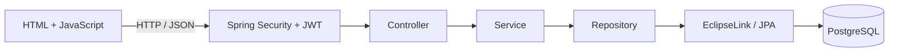
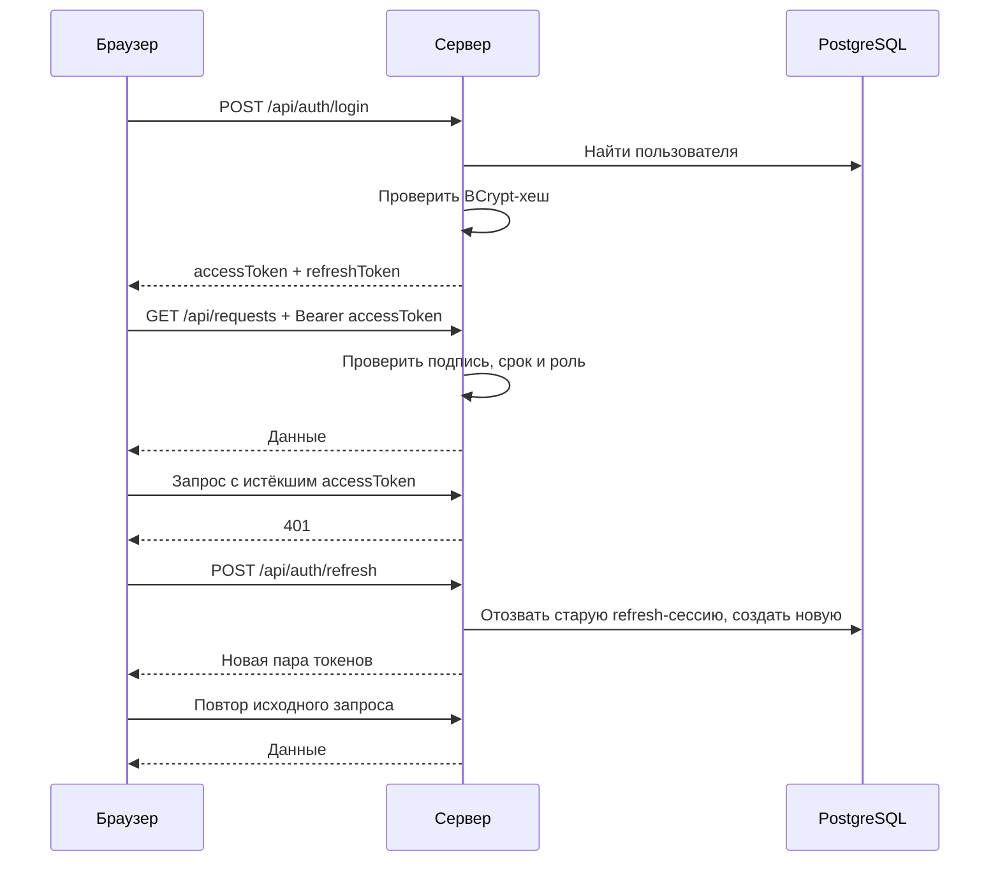

# Лабораторная работа №3: управление студентами на Java

Серверное приложение для управления студентами общежития. Backend предыдущей лабораторной перенесён с Django и JSON-хранилища на **Spring Boot, EclipseLink/JPA и PostgreSQL**. Интерфейс работает в браузере; регистрация, вход и права доступа проверяются сервером.

## Содержание

- [Возможности](#возможности)
- [Стек и назначение инструментов](#стек-и-назначение-инструментов)
- [Установка на Windows](#установка-на-windows)
- [Первый запуск](#первый-запуск)
- [Подключение к существующей базе](#подключение-к-существующей-базе)
- [Настройки, пароли и ключи](#настройки-пароли-и-ключи)
- [Архитектура и структура файлов](#архитектура-и-структура-файлов)
- [Модель данных и валидация](#модель-данных-и-валидация)
- [REST API](#rest-api)
- [Авторизация и роли](#авторизация-и-роли)
- [Swagger, Postman и тесты](#swagger-postman-и-тесты)
- [Частые проблемы](#частые-проблемы)

## Возможности

- Просмотр списка студентов и отдельного досье.
- Создание, полное обновление через PUT, частичное обновление через PATCH и удаление.
- Поиск по полям, сортировка, пагинация.
- Регистрация, вход по имени пользователя или email, автоматическое обновление токенов, выход.
- Роли **USER** и **ADMIN**, ограничения на backend и отображение соответствующих действий в интерфейсе.
- Проверка данных в браузере и на сервере, единый формат ошибок.
- Хранение студентов, пользователей и refresh-сессий в PostgreSQL.

## Стек и назначение инструментов

| Инструмент | Использование |
| --- | --- |
| Java / JDK 17 | Язык backend, компилятор и среда запуска |
| Maven | Скачивание зависимостей, сборка, запуск и тесты; настройки в `pom.xml` |
| Spring Boot 3.3.4 | Запуск приложения и встроенного HTTP-сервера Tomcat |
| Spring Web | Контроллеры, маршруты, преобразование JSON в DTO |
| Spring Data JPA | Репозитории, CRUD, запросы, сортировка и пагинация |
| EclipseLink 4.0.4 | Реализация JPA: преобразование Java-объектов в SQL и обратно |
| PostgreSQL | Основная реляционная база данных; проект проверен с PostgreSQL 18.6 |
| Spring Security | Проверка JWT и прав ролей |
| JJWT 0.12.6 | Создание и проверка подписанных JWT |
| BCrypt | Хеширование паролей |
| Jakarta Validation | Проверка ограничений DTO |
| springdoc-openapi 2.6.0 | Swagger UI и описание API |
| HTML, CSS, JavaScript | Страницы и работа с API через `fetch` |
| H2 | Отдельная база для автоматических тестов; не используется вместо PostgreSQL при обычном запуске |

**Java, JavaScript и JSON — разные вещи.** Java выполняется на сервере, JavaScript — в браузере, JSON — формат обмена данными. Node.js, Python и Docker для запуска третьей лабораторной не требуются.

## Установка на Windows

### 1. Git и исходный код

Установите [Git](https://git-scm.com/downloads), если команда `git` недоступна. В терминале:

```powershell
git clone https://github.com/qulin-ds/student-management.git
cd "student-management\3 lab"
```

Если репозиторий уже скачан, откройте терминал в его папке `3 lab`. Не клонируйте второй раз поверх существующей папки.

### 2. JDK 17

Скачайте [Eclipse Temurin JDK 17](https://adoptium.net/temurin/releases/?version=17): Windows, x64, **JDK**, установщик MSI. При установке включите добавление в `PATH` и настройку `JAVA_HOME`.

Перезапустите терминал и проверьте:

```powershell
java -version
javac -version
```

Обе команды должны показывать Java 17. JRE без компилятора для разработки недостаточно.

### 3. Maven

Скачайте стабильный Maven 3.x со [страницы Apache Maven](https://maven.apache.org/download.cgi), архив **Binary zip archive**. Распакуйте его и добавьте папку `apache-maven-…\bin` в пользовательский `Path`. Внутри должна находиться команда `mvn.cmd`.

Полностью перезапустите VS Code/терминал и проверьте:

```powershell
mvn -version
```

Команда должна показать Maven и JDK 17. В проекте Maven Wrapper не включён, поэтому команда `mvn` должна быть установлена отдельно. См. [официальную инструкцию Maven](https://maven.apache.org/install.html).

### 4. PostgreSQL и pgAdmin

Этот пункт нужен для собственной локальной базы. **Если используете готовую базу напарника, создавать новую и устанавливать локальный PostgreSQL Server не нужно** — переходите к [инструкции подключения](#подключение-к-существующей-базе).

Скачайте установщик через [официальную страницу PostgreSQL для Windows](https://www.postgresql.org/download/windows/). Для повторения проверенного окружения можно использовать PostgreSQL 18.x.

Установите PostgreSQL Server, pgAdmin 4 и Command Line Tools. Дополнения Stack Builder для этой лабы не нужны. Оставьте порт `5432`; сохраните пароль пользователя `postgres`.

В pgAdmin подключитесь к серверу, затем **Databases → Create → Database**:

- Database: `student_management`;
- Owner: `postgres`.

Альтернативно выполните SQL в подключении к существующей базе `postgres`:

```sql
CREATE DATABASE student_management;
```

Таблицы приложения отдельно создавать не нужно: их создаёт EclipseLink при первом запуске.

### 5. Редактор

Можно использовать VS Code с [Extension Pack for Java](https://code.visualstudio.com/docs/java/java-tutorial) или другую Java IDE. Расширение помогает с импортами, подсказками и отладкой; сам сервер запускается через Maven.

## Первый запуск

Этот сценарий создаёт администратора для вашей базы. Для уже существующей общей базы с готовыми аккаунтами используйте [отдельную пошаговую инструкцию](#подключение-к-существующей-базе).

Все команды этого раздела выполняются в папке **`3 lab`**.

```powershell
powershell -ExecutionPolicy Bypass -File .\start.ps1
```

Параметр `ExecutionPolicy` действует для запускаемого процесса PowerShell, а не меняет постоянную политику Windows.

Скрипт:

1. Переходит в папку проекта.
2. Спрашивает пароль PostgreSQL, если `DB_PASSWORD` ещё не задан.
3. Спрашивает имя, email и пароль администратора, если соответствующие переменные не заданы.
4. Запускает `mvn spring-boot:run`.

Для нового администратора выберите свободные имя и email. Имя: 3–50 латинских букв, цифр или `_`; пароль: 8–72 символа, не более 72 байт UTF-8. Для BCrypt многобайтовый пароль может достигнуть лимита байт раньше лимита символов.

После строки `Started StudentManagementApplication` откройте:

- [Сайт](http://localhost:8080/);
- [Swagger UI](http://localhost:8080/swagger-ui/index.html).

Входите на сайт **данными администратора**, а не паролем PostgreSQL. Регистрация через сайт создаёт обычного USER. При повторном запуске существующий пользователь с указанным именем не перезаписывается; скрипт не сбрасывает пароль и не повышает существующего USER до ADMIN.

Первый запуск может занять больше времени, пока Maven скачивает библиотеки. Терминал с сервером нужно оставить открытым. Остановка: **Ctrl+C**. После изменения Java-кода сохраняйте файлы и перезапускайте сервер; после изменения CSS/JS обновляйте браузер через **Ctrl+F5**.

### Запуск без скрипта

Задайте переменные в текущем PowerShell; пароль можно ввести без отображения:

```powershell
$dbPassword = Read-Host "Пароль PostgreSQL" -AsSecureString
$env:DB_PASSWORD = [System.Net.NetworkCredential]::new("", $dbPassword).Password

$env:ADMIN_USERNAME = "admin"
$env:ADMIN_EMAIL = "admin@example.com"
$adminPassword = Read-Host "Пароль нового администратора" -AsSecureString
$env:ADMIN_PASSWORD = [System.Net.NetworkCredential]::new("", $adminPassword).Password

mvn spring-boot:run
```

После создания администратора повторный запуск через `mvn spring-boot:run` может выполняться без `ADMIN_*`; подключение к БД по-прежнему должно быть настроено. Стандартного пользователя `user` и генерируемого Spring-пароля теперь нет: используются аккаунты из PostgreSQL.

### Сборка запускаемого файла

```powershell
mvn package
java -jar .\target\student-management-0.0.1-SNAPSHOT.jar
```

Переменные окружения задайте перед запуском JAR так же, как при запуске Maven. Для сохранения JWT-ключей в одном месте запускайте приложение из папки `3 lab`.

## Подключение к существующей базе

Этот сценарий для напарника, который скачал проект и **хочет использовать уже готовую базу**, а не создавать новую. База должна принадлежать этому приложению и использовать совместимые таблицы; произвольная чужая база для запуска не подходит.

### Шаг 1. Выберите, что именно подключаете

| Что нужно | Что делать |
| --- | --- |
| Просто пользоваться уже запущенным сайтом напарника | Попросить адрес сайта и аккаунт; открыть сайт в браузере. Java, Maven и пароль БД для этого не нужны |
| Запустить свой Java-сервер с общей готовой базой | Выполнить шаги ниже: установить JDK/Maven/Git и указать адрес существующей PostgreSQL |
| Запустить проект полностью независимо | Создать свою локальную базу по разделу установки выше |

**`localhost` всегда означает ваш собственный компьютер.** Если база находится на компьютере напарника, адрес `localhost:5432` не подключит вас к нему. Нужен доступный адрес его компьютера/сервера, например в общей локальной сети или VPN.

### Шаг 2. Запросите данные у владельца

Перед настройкой отправьте владельцу базы такой запрос:

> Хочу запустить backend третьей лабы с вашей существующей базой. Пришлите адрес PostgreSQL, порт, название базы, имя пользователя для подключения и его пароль. Скажите, нужен ли VPN, SSL или SSH-туннель и разрешён ли доступ с моего компьютера. Также нужен аккаунт сайта: имя/email и пароль, либо возможность зарегистрировать собственный. Если мне нужно редактирование студентов, нужен отдельный аккаунт ADMIN.

В результате у вас должны быть **две отдельные группы данных**:

| Данные | Где используются | У кого узнать |
| --- | --- | --- |
| Адрес БД, порт, имя базы | `DB_URL` перед запуском сервера | Владелец базы |
| Пользователь PostgreSQL | `DB_USERNAME` | Владелец базы |
| Пароль PostgreSQL | `DB_PASSWORD` | Владелец базы; вводится локально, не в README |
| Имя/email и пароль аккаунта сайта | Форма входа в браузере | Владелец аккаунта или создайте собственный USER через регистрацию |

Пароль БД не становится паролем администратора сайта. **Не придумывайте новый пароль подключения:** используйте выданный владельцем. Если пароль неизвестен, его нужно получить у владельца либо попросить владельца настроить доступ для отдельного пользователя PostgreSQL. Настоящие пароли передавайте отдельно от публичного репозитория.

В текущей реализации при запуске EclipseLink создаёт/дополняет таблицы, а `JpaConfig` выполняет расширение колонки заметок. Пользователю БД нужны согласованные с владельцем права чтения/изменения данных, работы с последовательностями и создания/изменения нужных таблиц. Аккаунт только для чтения не подойдёт даже для запуска backend.

### Шаг 3. Убедитесь, что база доступна с вашего компьютера

Если база находится у владельца, он должен обеспечить сетевой доступ к ней. Для обычного PostgreSQL это означает настройку нужного сетевого интерфейса в `listen_addresses`, разрешение вашего подключения в `pg_hba.conf` и соответствующего доступа в сетевом экране. Делает это владелец сервера; это не достигается заменой пароля или копированием проекта. См. официальную документацию [сетевых подключений](https://www.postgresql.org/docs/current/runtime-config-connection.html) и [pg_hba.conf](https://www.postgresql.org/docs/current/auth-pg-hba-conf.html).

Используйте согласованную локальную сеть/VPN или туннель; не открывайте доступ к базе для всех адресов. Если владелец дал готовый JDBC-адрес с параметрами SSL, сохраните эти параметры и используйте его без изменений.

На своём компьютере PostgreSQL Server устанавливать **не нужно**, если используете удалённую готовую базу. Нужны JDK 17, Maven и Git. pgAdmin необязателен: Java подключится через JDBC-драйвер из `pom.xml`.

### Шаг 4. Скачайте проект и откройте терминал

```powershell
git clone https://github.com/qulin-ds/student-management.git
cd "student-management\3 lab"
java -version
mvn -version
```

Если репозиторий уже есть, просто откройте терминал в папке `3 lab`. Команды `java` и `mvn` должны работать; Maven должен использовать JDK 17.

### Шаг 5. Введите полученные данные PostgreSQL

Выполняйте команды в **одном и том же терминале PowerShell**. Значения после `Read-Host` вводятся интерактивно, их не нужно вставлять в исходные файлы.

```powershell
$dbHost = Read-Host "Адрес PostgreSQL, полученный от владельца"
$dbPort = Read-Host "Порт PostgreSQL (Enter для 5432)"
if ([string]::IsNullOrWhiteSpace($dbPort)) { $dbPort = "5432" }
$dbName = Read-Host "Название существующей базы"
$env:DB_USERNAME = Read-Host "Имя пользователя PostgreSQL"
$env:DB_URL = "jdbc:postgresql://${dbHost}:${dbPort}/${dbName}"

$dbPassword = Read-Host "Пароль PostgreSQL, полученный от владельца" -AsSecureString
$env:DB_PASSWORD = [System.Net.NetworkCredential]::new("", $dbPassword).Password
```

При вводе пароля символы не отображаются — это нормально. Переменные передаются запускаемому Java-процессу и не записываются в Git. Они действуют в текущем терминале; в новом терминале настройку нужно повторить.

Если владелец вместо отдельных параметров предоставил **полный JDBC URL**, замените значение `DB_URL`:

```powershell
$env:DB_URL = Read-Host "Полный JDBC URL, полученный от владельца"
```

Пароль вводите отдельно в `DB_PASSWORD`, не добавляйте его в URL.

Для проверки TCP-доступности можно выполнить:

```powershell
Test-NetConnection -ComputerName $dbHost -Port ([int]$dbPort)
```

`TcpTestSucceeded: True` означает, что порт доступен; это **ещё не проверка** пароля и существования базы. При `False` сначала согласуйте с владельцем адрес, VPN/туннель и настройки доступа.

### Шаг 6. Запустите сервер без создания нового ADMIN

Если в общей базе аккаунты уже существуют, **не запускайте интерактивный `start.ps1`**: он предназначен в том числе для начального создания администратора и будет спрашивать его данные. Используйте обычный запуск Maven.

Очистите настройки начального создания ADMIN, если они остались от предыдущего запуска в этом терминале:

```powershell
Remove-Item Env:ADMIN_USERNAME -ErrorAction SilentlyContinue
Remove-Item Env:ADMIN_EMAIL -ErrorAction SilentlyContinue
Remove-Item Env:ADMIN_PASSWORD -ErrorAction SilentlyContinue
mvn spring-boot:run
```

Эти команды **не удаляют пользователей из базы и не сбрасывают пароли**. Они только убирают настройки первоначального создания ADMIN из текущего окружения.

Дождитесь `Started StudentManagementApplication`. Если приложение не запускается:

- ошибка соединения — проверьте адрес/порт и доступность сервера БД;
- ошибка аутентификации PostgreSQL — перепроверьте `DB_USERNAME` и пароль у владельца;
- ошибка отсутствующей базы — уточните название, не создавайте новую наугад;
- ошибка прав на таблицу/схему — владелец должен выдать необходимые права выбранному пользователю;
- порт 8080 занят — остановите старый backend или задайте `$env:SERVER_PORT = "8081"` и повторите запуск.

### Шаг 7. Откройте сайт и войдите

Откройте [http://localhost:8080/](http://localhost:8080/), либо порт, который вы указали в `SERVER_PORT`. Здесь `localhost` правильный: **ваш Java-сервер** работает на вашем компьютере, хотя база может быть у напарника.

Введите имя/email и пароль **аккаунта сайта**, полученные на шаге 2. Введённый при запуске пароль PostgreSQL в этой форме не используется.

Если владелец разрешил регистрацию, можно зарегистрировать собственный аккаунт. Он получит USER и сможет читать студентов. Для редактирования нужен ADMIN; договоритесь о его выдаче с владельцем. Другой пароль в `ADMIN_PASSWORD` не заменяет пароль существующего аккаунта.

Не пытайтесь извлечь пароль сайта из таблицы `app_users`: там хранится BCrypt-хеш. Если пароль аккаунта забыт, его нужно сбросить отдельной согласованной процедурой; публичного маршрута сброса пароля в этой лабе нет.

### Шаг 8. Учитывайте общие данные и JWT

Вы работаете **с той же базой**: созданные, изменённые и удалённые студенты будут видны другим участникам. Используйте согласованные тестовые записи. Не запускайте Postman-коллекцию или интеграционные тесты на общей базе без согласования: они изменяют данные.

Сам пароль БД не задаёт JWT-ключи. Для независимого локального backend можно оставить автоматическую генерацию ключей и входить через его собственную форму входа. Токены, выданные другим сервером с другими ключами, здесь не подойдут.

Если нужна возможность использовать одни и те же токены между несколькими серверами, владельцы должны отдельно согласовать одинаковые `JWT_ACCESS_SECRET` и `JWT_REFRESH_SECRET` для этих серверов. Полученные секреты задаются в окружении, не публикуются в Git; они не являются `ADMIN_PASSWORD`.

Остановка вашего backend: **Ctrl+C**. Она не останавливает PostgreSQL на компьютере владельца.


## Настройки, пароли и ключи

Настройки находятся в [`application.yml`](src/main/resources/application.yml), пример переменных — в [`.env.example`](.env.example).

**Spring не загружает `.env` автоматически.** Копирование `.env.example` в `.env` само по себе не настраивает запуск. Используйте переменные окружения или `start.ps1`.

| Переменная | Назначение | Значение по умолчанию |
| --- | --- | --- |
| `SERVER_PORT` | Порт сайта | `8080` |
| `DB_URL` | JDBC-адрес БД | `jdbc:postgresql://localhost:5432/student_management` |
| `DB_USERNAME` | Пользователь PostgreSQL | `postgres` |
| `DB_PASSWORD` | Пароль подключения к PostgreSQL | `postgres`; заменяется вашим паролем через скрипт/окружение |
| `ADMIN_USERNAME` | Имя администратора для начального создания | пусто |
| `ADMIN_EMAIL` | Email администратора | пусто |
| `ADMIN_PASSWORD` | Начальный пароль администратора | пусто |
| `JWT_ACCESS_SECRET` | Секрет подписи access JWT | генерируется локально, если не задан |
| `JWT_REFRESH_SECRET` | Секрет подписи refresh JWT | генерируется локально, если не задан |
| `JWT_ACCESS_TTL_MINUTES` | Срок access-токена | `15` минут |
| `JWT_REFRESH_TTL_DAYS` | Срок refresh-токена | `30` дней |

### Три разных вида секретов

1. **Пароль PostgreSQL:** используется сервером для подключения к базе.
2. **Пароль аккаунта сайта:** используется при входе; в базе хранится BCrypt-хеш.
3. **JWT-ключи:** сервер подписывает и проверяет токены; клиенту ключи не передаются.

Если JWT-секреты не заданы, сервер создаёт случайные ключи по 32 байта и сохраняет их в `data/access.key` и `data/refresh.key`. Они сохраняются между перезапусками. Если задаёте собственные секреты, они должны быть разными и каждый содержать минимум 32 байта UTF-8. Файлы ключей содержат Base64-представление случайных байтов, а переменные окружения принимают непосредственно текст секрета.

`data/`, `.env`, логи и `target/` исключены из Git. Изменение JWT-ключей делает ранее выданные токены непригодными. Для нескольких экземпляров одного общего сервера нужны согласованные ключи и общая БД; у отдельных локальных установок ключи и пароли БД могут быть разными.

## Архитектура и структура файлов



Например, при создании студента контроллер принимает JSON и запускает валидацию DTO. Сервис проверяет дату и уникальность ИСУ. Mapper создаёт Entity, Repository сохраняет её через EclipseLink, а клиент получает DTO с HTTP-статусом `201`.

```text
3 lab/
  pom.xml                         зависимости и сборка
  start.ps1                       интерактивный запуск
  .env.example                    описание переменных
  postman/                        коллекция запросов
  src/main/java/dev/geeks/studentmanagement/
    StudentManagementApplication  точка входа
    student/
      StudentController           маршруты студентов
      StudentService              CRUD, фильтры, сортировка, пагинация
      dto/                        входные и выходные данные API
      mapper/                     преобразование DTO и Entity
      model/                      Entity студента
      repository/                 доступ к таблице students
    auth/
      AuthController              регистрация, вход, refresh, logout, me
      AuthService                 аккаунты, BCrypt, выдача токенов
      dto/                        данные авторизации
      model/                      User, Role, RefreshSession
      repository/                 пользователи и refresh-сессии
    security/
      JwtService                  подпись, срок действия, проверка JWT
      JwtAuthenticationFilter     чтение Bearer-токена из запроса
    config/
      JpaConfig                   EclipseLink, таблицы, транзакции
      SecurityConfig              правила доступа
      OpenApiConfig               Swagger и Bearer-схема
      AdminBootstrap              начальное создание ADMIN
      PageController              выдача HTML-страниц
      QueryMethodFilter           совместимость с методом QUERY
    common/
      error/                      ApiError и обработчики ошибок
      exception/                  исключения конфликта и отсутствия записи
  src/main/resources/
    application.yml               настройки
    templates/                    HTML без шаблонизатора Django/Thymeleaf
    static/css/                   оформление
    static/js/                    формы, API, токены, валидация
  src/test/                       интеграционный тест
```

`@Configuration` описывает настройки; `@Bean` создаёт управляемый Spring объект. Сервисы получают репозитории через конструкторы — это внедрение зависимостей. `@Transactional` задаёт границу транзакции: изменения сохраняются вместе либо откатываются при ошибке.

JPA — интерфейсы и правила работы с объектами и реляционной БД; **EclipseLink — выбранная реализация**. Hibernate исключён из зависимостей. `JpaConfig` создаёт `entityManagerFactory` и `transactionManager` явно.

Таблицы создаются/дополняются EclipseLink. Колонка `students.note` при запуске на PostgreSQL расширяется до 2000 символов, чтобы ранняя версия таблицы не ограничивала заметки 255 символами. Записи не удаляются. Полноценной системы версионированных миграций в проекте нет.

## Модель данных и валидация

| Поле студента в JSON | Правило |
| --- | --- |
| `ISU` | Первичный ключ: целое число 100000–999999; уникально и неизменно |
| `name` | 2–3 части ФИО; максимум 60 символов; в каждой части минимум две русские/латинские буквы, допускается дефис |
| `group` | Одна русская/латинская буква и 4–5 цифр |
| `dormitory` | Целое число 1–20 |
| `room` | Целое число 1000–9999 |
| `checkin_date` | Дата `YYYY-MM-DD`, с 2016 года, не позже текущей даты сервера |
| `is_foreign` | Обязательное логическое `true`/`false` |
| `note` | Необязательная заметка, максимум 2000 символов |

Проверка ФИО проверяет структуру, а не существование человека. В браузере лишние обычные пробелы в ФИО нормализуются. Сервер остаётся главным источником проверки, даже если клиентскую проверку обойти.

В JSON также принимаются `checkinDate` и `isForeign` для совместимости с Java DTO; ответ использует `checkin_date` и `is_foreign`.

Пользователь имеет автоматически создаваемый первичный ключ `id`, уникальные `username` и `email`, `passwordHash` и роль. Email при регистрации приводится к нижнему регистру. Refresh-сессия содержит идентификатор токена, имя пользователя, срок и признак отзыва.

## REST API

Защищённые запросы требуют заголовок:

```http
Authorization: Bearer <accessToken>
```

| Метод | Маршрут | Доступ | Результат |
| --- | --- | --- | --- |
| POST | `/api/auth/register` | публичный | USER и пара токенов, `201` |
| POST | `/api/auth/login` | публичный | пара токенов, `200` |
| POST | `/api/auth/refresh` | по refresh-токену | новая пара, `200` |
| POST | `/api/auth/logout` | по refresh-токену | отзыв refresh, `204` |
| GET | `/api/auth/me` | USER / ADMIN | имя и роль |
| GET | `/api/requests` | USER / ADMIN | список и метаданные страницы |
| GET | `/api/requests/{isu}` | USER / ADMIN | один студент |
| POST | `/api/requests` | ADMIN | создание, `201` |
| PUT | `/api/requests/{isu}` | ADMIN | полная замена, `200` |
| PATCH | `/api/requests/{isu}` | ADMIN | частичное изменение, `200` |
| DELETE | `/api/requests/{isu}` | ADMIN | удаление, `204` |
| QUERY | `/api/requests` | USER / ADMIN | фильтрация через JSON |
| POST | `/api/requests/search` | USER / ADMIN | альтернативный поиск через JSON |

Метод QUERY сохраняет контракт предыдущей лабы. `QueryMethodFilter` направляет такой запрос в обработчик поиска до проверки ролей; для инструментов без поддержки QUERY используйте POST `/api/requests/search`.

### Пример создания / PUT

```json
{
  "ISU": 123456,
  "name": "Иванов Иван Иванович",
  "group": "P1234",
  "dormitory": 5,
  "room": 1234,
  "checkin_date": "2020-09-01",
  "is_foreign": false,
  "note": "Пример записи"
}
```

Ответы одного студента обёрнуты в `{"data": {...}}`. PUT требует все обязательные поля и совпадение ИСУ тела с ИСУ в адресе; отсутствующая заметка очищается.

PATCH может содержать только нужные поля:

```json
{ "room": 4321, "note": "" }
```

В PATCH отсутствующие или `null`-поля сохраняют прежнее значение; `note: ""` очищает заметку. Поля `ISU` в DTO PATCH нет, попытка его передать отклоняется.

### Фильтры, сортировка и страницы

```text
GET /api/requests?group=P1234&is_foreign=false&sort=name,asc&page=0&size=10
```

Фильтры: `ISU`, `name`, `group`, `dormitory`, `room`, `is_foreign` (для Java-контракта также `isForeign`). Используется точное совпадение, без поиска подстроки.

Сортировка: `поле,asc` или `поле,desc`. Поля: `ISU`, `name`, `group`, `dormitory`, `room`, `checkinDate`, `isForeign`, `note`. По умолчанию — ИСУ по возрастанию; для стабильного порядка к другим полям добавляется ИСУ.

Нумерация страниц начинается с `0`, размер страницы — 1–100, по умолчанию `20`. Ответ списка:

```json
{
  "data": [],
  "page": 0,
  "size": 20,
  "totalElements": 0,
  "totalPages": 0
}
```

Для QUERY/POST search эти параметры передаются JSON-объектом, например `{"group":"P1234","page":0,"size":10}`.

### Ошибки

`GlobalExceptionHandler` возвращает единый объект:

```json
{
  "error": {
    "code": "UNPROCESSABLE_ENTITY",
    "message": "Проверьте введённые данные",
    "status": 422,
    "timestamp": "2026-10-14T12:00:00Z",
    "details": { "room": "must be greater than or equal to 1000" }
  }
}
```

`400` — формат запроса/параметры, `401` — требуется вход/неверный токен, `403` — недостаточно прав, `404` — ресурс отсутствует, `409` — конфликт уникальности, `422` — валидация, `500` — внутренняя ошибка. Подробности внутренних ошибок пишутся в серверный лог, клиент получает общее сообщение.

## Авторизация и роли



Токены хранятся в `sessionStorage` вкладки браузера. `auth.js` добавляет Bearer-заголовок и при `401` пытается обновить токены, затем повторяет запрос. При неудаче возвращает пользователя на вход.

Публичная регистрация всегда создаёт USER; передать себе ADMIN в запросе нельзя. ADMIN создаётся из локальных переменных окружения. Проверка подписи и срока выполняется JWT-фильтром; текущая роль берётся из базы. Скрытие кнопок в браузере дополнительно помогает пользователю, но права обеспечиваются `SecurityConfig`.

Refresh-токены ротируются: после успешного обновления старый использовать повторно нельзя. Выход отзывает refresh-сессию. Уже выданный access-токен остаётся действителен до истечения срока; отдельного списка отозванных access-токенов нет.

## Swagger, Postman и тесты

### Swagger

1. Откройте [Swagger UI](http://localhost:8080/swagger-ui/index.html).
2. Выполните POST `/api/auth/login` с username и password.
3. Скопируйте `accessToken`.
4. В **Authorize** вставьте только токен, без слова `Bearer`.
5. Выполняйте защищённые запросы через **Try it out → Execute**.

Swagger не является интерфейсом сайта и не выполняет автоматический refresh так, как `auth.js`. После истечения токена выдайте новый через refresh/login и обновите Authorize.

### Postman

Импортируйте [`postman/Lab3.postman_collection.json`](postman/Lab3.postman_collection.json). Задайте переменные коллекции: `baseUrl`, `adminUsername`, `adminPassword`, `userUsername`, `userEmail`, `userPassword`. Пароли оставлены пустыми специально.

После входа ADMIN и refresh скрипты коллекции сохраняют токены автоматически. Регистрация USER сохраняет отдельный `userAccessToken`. Есть запросы CRUD, поиска, обновления токена и проверки запрета создания для USER. Для повторной регистрации используйте свободные username/email; для повторного создания удалите прежнего тестового студента или измените ИСУ. Коллекцию запускайте на своей учебной базе: она создаёт и удаляет запись с ИСУ `123456`.

### Автоматические тесты

```powershell
mvn test
```

Интеграционный сценарий проверяет регистрацию, дубли аккаунтов, BCrypt, вход, роли, refresh-ротацию и выход, CRUD, ошибки, фильтры, сортировку, пагинацию, QUERY, HTML-маршруты и OpenAPI. Отдельный тест ФИО проверяет допустимые и недопустимые значения.

По умолчанию тесты используют отдельную H2 в памяти, а не вашу PostgreSQL-базу. Проверка H2 не заменяет проверку особенностей PostgreSQL: приложение также проверялось на отдельном PostgreSQL 18.6.

При необходимости задайте `LAB_TEST_DB_URL`, `LAB_TEST_DB_USER` и `LAB_TEST_DB_PASSWORD` для **отдельной пустой тестовой базы**. Тесты создают пользователей и студентов; повторный запуск против той же PostgreSQL-базы требует подготовки чистой тестовой базы. Не указывайте рабочую `student_management`.

## Частые проблемы

| Симптом | Что проверить |
| --- | --- |
| `java`, `javac` или `mvn` не распознаны | Установка и `PATH`; перезапустить все окна VS Code |
| Maven использует другую Java | `JAVA_HOME` и строка Java version в `mvn -version` |
| `entityManagerFactory` не найден | Сохранён ли `config/JpaConfig.java`; правильный `package` |
| Соединение с PostgreSQL отклонено | Работает ли сервер БД; адрес и порт в `DB_URL` |
| Ошибка пароля PostgreSQL | `DB_PASSWORD` — пароль БД, а не сайта; обновить переменную после смены пароля |
| База не существует | Создать `student_management` в pgAdmin |
| Порт 8080 занят | Остановить прежний сервер или задать `$env:SERVER_PORT = "8081"` |
| Вход `user` со старым Spring-паролем не работает | Теперь используются аккаунты сайта из PostgreSQL |
| Регистрация есть, но кнопок изменения нет | Зарегистрированный пользователь имеет роль USER |
| Изменения не видны | Сохранить файлы, перезапустить backend; Ctrl+F5 для CSS/JS |
| Студент не проходит новую проверку ФИО | Старые записи автоматически не исправляются; отредактировать ФИО |
| После замены JWT-ключей требуется вход | Старые подписи больше не проходят проверку |
| `.env` не влияет на запуск | Задать переменные окружения; автоматической загрузки `.env` нет |

Если переменная пароля в терминале устарела, удалите её и запустите скрипт снова — он спросит новый пароль:

```powershell
Remove-Item Env:DB_PASSWORD -ErrorAction SilentlyContinue
powershell -ExecutionPolicy Bypass -File .\start.ps1
```

Это учебный локальный проект. Для размещения в интернете нужны отдельные настройки HTTPS, серверных секретов, доступа к PostgreSQL и миграций. GitHub хранит исходники; отправка кода на GitHub сама по себе не запускает Java-сервер и PostgreSQL.
