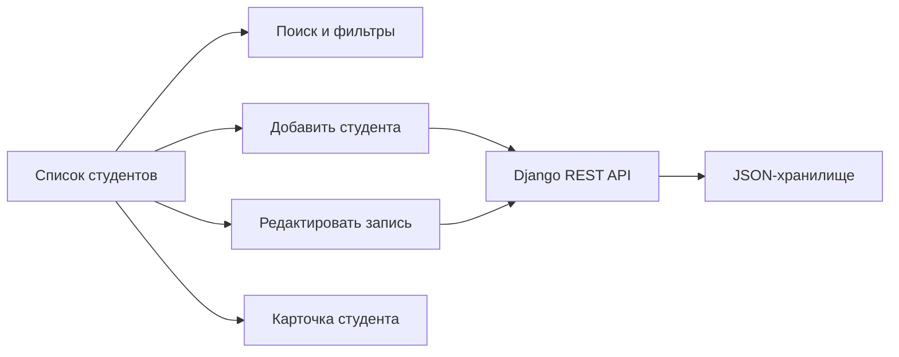

# 🏠 Student Management · Веб-программирование

**Стек:** HTML · CSS · JavaScript · Python · Django REST Framework



*Схема функций приложения по исходному коду.*

## Участие в проекте

Командный учебный проект Geeks, разработанный с Андреем Сырчиным. Реализация включает список студентов, формы создания и редактирования, клиентскую и серверную валидацию и REST API. [Frontend](1-2%20lab/static/js), [API](1-2%20lab/students/views.py), [описание командной работы](docs/labs-1-2.md).

Учебный проект команды Geeks: управление студентами общежития.

| Этап | Реализация | Статус источника |
| --- | --- | --- |
| Лабораторная 1 | HTML/CSS/JS, CRUD, cookies, валидация | Реализация в `1-2 lab/` |
| Лабораторная 2 | Django + DRF, REST API, JSON-хранилище | Реализация в `1-2 lab/` |
| Лабораторная 3 | Spring Boot, JPA, JWT и роли | Заготовка в `3 lab/` |

## Запуск лабораторных 1–2

```sh
cd "1-2 lab"
python -m pip install -r requirements.txt
python manage.py runserver
```

Откройте `http://127.0.0.1:8000`. Инструкции и ограничения: [описание лабораторных](docs/labs-1-2.md), [README лабораторных 1–2](1-2%20lab/README.md), [README лабораторной 3](3%20lab/README.md).

Это учебный стенд с режимом отладки. Для публичного развёртывания нужны отдельные настройки безопасности. Django-ключ для локального запуска генерируется при старте, либо задаётся через переменную `DJANGO_SECRET_KEY`; встроенный ключ источника удалён из этой копии.

Перенесено из [geek-masters/web2026-geeks](https://sourcecraft.dev/geek-masters/web2026-geeks). [Исходное описание](docs/source-readme.md) сохранено, включая сведения о командном проекте.
