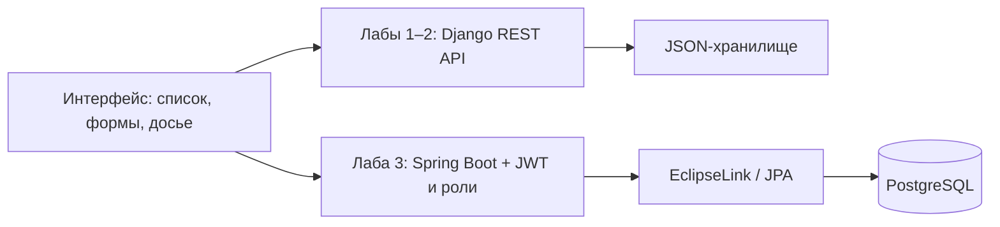

# 🏠 Student Management · Веб-программирование

**Стек:** HTML · CSS · JavaScript · Python/Django (лабы 1–2) · Java/Spring Boot · EclipseLink/JPA · PostgreSQL (лаба 3)



*Две реализации backend для разных этапов курса; третья лабораторная использует PostgreSQL.*

## Участие в проекте

Командный учебный проект Geeks, разработанный с Андреем Сырчиным. Реализация включает список студентов, формы создания и редактирования, клиентскую и серверную валидацию и REST API. [Frontend](1-2%20lab/static/js), [API](1-2%20lab/students/views.py), [описание командной работы](docs/labs-1-2.md).

Учебный проект команды Geeks: управление студентами общежития.

| Этап | Реализация | Статус источника |
| --- | --- | --- |
| Лабораторная 1 | HTML/CSS/JS, CRUD, cookies, валидация | Реализация в `1-2 lab/` |
| Лабораторная 2 | Django + DRF, REST API, JSON-хранилище | Реализация в `1-2 lab/` |
| Лабораторная 3 | Spring Boot + EclipseLink/JPA + PostgreSQL, JWT и роли | Реализация и тесты в `3 lab/` |

## 📚 Материалы к защите лабораторных

Добавлены подробные конспекты по вопросам из технических заданий. В каждом конспекте — теория, привязка к файлам проекта, примеры и план демонстрации.

- **[Лабораторная №1 — Frontend: HTML, CSS, JavaScript, DOM, формы, cookies и CRUD](1-2%20lab/DEFENSE_LAB1.md)**
- **[Лабораторная №2 — Backend: Python, Django REST Framework, REST API, валидация, HTTP и stateless](1-2%20lab/DEFENSE_LAB2.md)**
- **[Лабораторная №3 — Java Backend: Spring Boot, JPA/PostgreSQL, JWT, авторизация и роли](3%20lab/DEFENSE.md)**

**Приоритет подготовки к лабораторной №3:** сначала разберите полный поток `запрос → JWT-фильтр → проверка роли → контроллер → сервис → репозиторий/JPA → PostgreSQL → JSON-ответ`, затем пройдите 16 вопросов конспекта и сценарий демонстрации. В лабораторной №3 уже есть отдельный большой `DEFENSE.md`; он сохранён, не заменён кратким пересказом.

## Запуск лабораторных 1–2

```sh
cd "1-2 lab"
python -m pip install -r requirements.txt
python manage.py runserver
```

Откройте `http://127.0.0.1:8000`. Инструкции: [описание лабораторных](docs/labs-1-2.md), [README лабораторных 1–2](1-2%20lab/README.md), [README лабораторной 3](3%20lab/README.md).

Это учебный стенд с режимом отладки. Для публичного развёртывания нужны отдельные настройки безопасности. Django-ключ для локального запуска генерируется при старте, либо задаётся через переменную `DJANGO_SECRET_KEY`; встроенный ключ источника удалён из этой копии.

Перенесено из [geek-masters/web2026-geeks](https://sourcecraft.dev/geek-masters/web2026-geeks). [Исходное описание](docs/source-readme.md) сохранено, включая сведения о командном проекте.

## Лабораторная 3: локальный запуск

Рабочая реализация на **Java 17 + Spring Boot + EclipseLink/JPA + PostgreSQL**. Есть регистрация, JWT access/refresh, роли USER/ADMIN, CRUD студентов, фильтры, сортировка, страницы и Swagger.

**[Подробный README лабораторной 3](3%20lab/README.md)** объясняет установку, команды запуска, архитектуру, API, валидацию, пароли, ключи и тесты.

Установите PostgreSQL, создайте `student_management`, затем в папке репозитория выполните:

```powershell
cd "3 lab"
powershell -ExecutionPolicy Bypass -File .\start.ps1
```

Скрипт спросит пароль PostgreSQL и данные нового администратора. Сайт: [localhost:8080](http://localhost:8080/), [Swagger](http://localhost:8080/swagger-ui/index.html).

### Проверка

Из `3 lab` выполните `mvn test`; тесты по умолчанию используют отдельную H2. Коллекция [Postman](3%20lab/postman/Lab3.postman_collection.json) демонстрирует API и права ролей. Запускайте сценарии с изменением данных на отдельной учебной базе, а не на общей базе без согласования.

## Дополнительные инструкции

- [Подключение к готовой общей PostgreSQL](3%20lab/SHARED_DATABASE.md): требуется уже существующий сервер с разрешённым сетевым доступом. Эта инструкция не создаёт общий сервер; при обычном локальном запуске базы участников независимы.

## Материалы курса

[📚 Презентации лекций](lectures/README.md) — лекции 1–7, REST и Docker. PDF доступны для просмотра и скачивания.

## Подготовка к рубежке 27 октября

Создан отдельный раздел [exam/](exam/README.md): план подготовки, карта тем, конспекты лабораторных 1–4, практические задачи, 12 тренировочных билетов, решения, карточки и чек-лист готовности. Оригинальные лекции остаются в [lectures/](lectures/README.md). Статус исходных ТЗ и инструкции по добавлению PDF: [docs/lab-specs/](docs/lab-specs/README.md).
